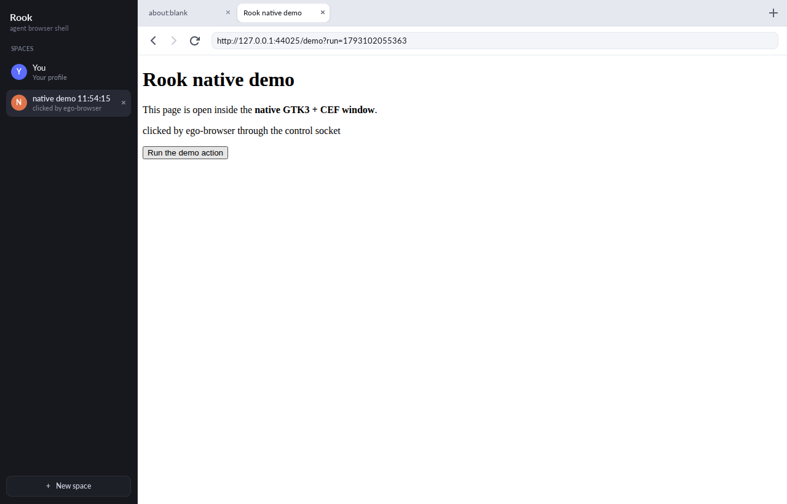
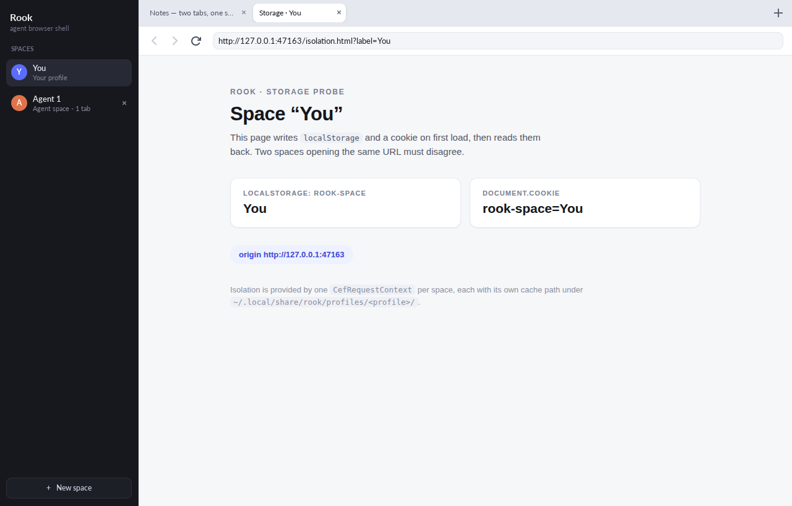

# Rook

A native agent browser for Linux. You browse in one window; agents work in
isolated spaces behind it.

Rook is a GTK3 window around the stock Chromium engine (CEF 156). Each agent
space is its own `CefRequestContext` with its own cookies, storage and cache, so
a session an agent drives never sees the cookies of the space you are using. A
handoff moves a space between you and the agent without copying anything.

It speaks the contract of CitroLabs' open-source `ego-browser` agent skill: the
same skill and CLI drive a real browser on Linux, against either Rook itself or
a stock Chromium, with the same commands. Compatibility is on the protocol, not
the brand — Rook is an independent project and is not affiliated with or
endorsed by CitroLabs.

## Screenshots



An agent round against the native app: a space created through the control
socket, a page loaded, a snapshot taken and a ref clicked. The window is showing
the space the round worked in.



The shell with a user space and an agent space side by side, captured by
`host/scripts/qa.sh`.

## Install

Ubuntu 23.10+/Debian 13+ (glibc ≥ 2.38, libstdc++ ≥ 13). The `.deb` bundles the
CEF runtime, Node 22 and the bridge; nothing else is required.

```sh
sudo apt install ./rook_0.3.0~m3_amd64.deb
rook
```

Or the AppImage, which needs no install:

```sh
chmod +x rook-0.3.0~m3-x86_64.AppImage
./rook-0.3.0~m3-x86_64.AppImage
```

The `.deb` is ~138 MB and the AppImage ~173 MB; both install to ~444 MB, most
of it the CEF runtime. The `.deb` installs the setuid sandbox helper and uses
Chromium's sandbox; an AppImage mount is `nosuid`, so it uses unprivileged user
namespaces instead, and warns once if the machine has neither.

## Quick start

Point the CLI at an `ego-browser` SDK build and run a script. With Rook running,
the round goes to the app; otherwise it goes to a headless Chrome.

```sh
scripts/build-sdk.sh                      # -> vendor/ego-browser/dist/out/index.js
export EGO_BROWSER_SDK_PATH=$PWD/vendor/ego-browser/dist/out/index.js

./bin/ego-browser nodejs <<'JS'
const task = await taskSpace("demo")
const page = task.page("p1")
await page.goto("https://example.com")
console.log(await page.snapshot())
await task.finish({ keep: [] })
JS
```

The same round, from an agent that has the skill installed, is a shell command:

```sh
ego-browser nodejs -e 'const t = await taskSpace("research")
await t.page("p1").goto("https://example.com")
await t.finish({ keep: [] })'
ego-browser skill            # the usage guide the skill ships with
ego-browser backend          # host or standalone, and why
```

`ROOK_BACKEND=host|standalone` forces one backend; `--standalone` on `nodejs` is
the same as `ROOK_BACKEND=standalone`. An explicit `host` is strict: if the app
is not running you get an error naming the socket, never a silent fallback.

## How it works

```
GTK3 window ── CefBrowser per tab ── CefRequestContext per space
     │
     └─ control socket  $XDG_RUNTIME_DIR/rook-<uid>.sock   (mode 0600)
              │  newline-delimited JSON-RPC 2.0: createSpace, createTab, cdp.send, …
        bridge (Node 22)  ── the `ego-browser` command
              │  globalThis.ego: task spaces, tabs, sendCDPMessage, snapshot
        agent / the ego-browser skill
```

The window owns Chromium and the pixels. The bridge owns task-space bookkeeping
and the accessibility-tree snapshot; it speaks CDP to a browser through the
socket, so the protocol surface is the same one Chrome exposes. Tabs are created
and closed through the app (`createTab`, `closeTab`, `activateTab`) rather than
through `Target.*`, because a DevTools-created browser belongs to no tab. Popups
are announced to the SDK with the opener the app actually recorded.

The same bridge runs against a stock Chrome (`standalone`), which is how the
whole surface is developed and tested without the app in the way.

The `ego-browser` SDK itself needs one Linux fix: upstream refuses
`page.keyboard.paste` outside macOS and Windows.
`patches/0001-linux-clipboard.patch` adds the Linux clipboard half, and
`patches/0002-vendor-build-root.patch` lets the patched copy build outside a git
checkout. `scripts/build-sdk.sh` applies both and builds the copy.

More detail: [docs/runtime.md](docs/runtime.md) for the bridge, tab mapping,
target lifecycle and snapshot pipeline; [host/README.md](host/README.md) for the
control protocol; [packaging/README.md](packaging/README.md) for the packages.

## Performance, measured

On 4 cores (Ryzen 9 9950X), 7.8 GiB RAM, from the packaged `.deb` running on a
private Xvfb. Three runs per row, spread is max − min. Full method and per-row
notes in [bench/report.md](bench/report.md).

| Metric | Target | Measured | Verdict |
|---|---|---|---|
| Cold start to first paint | ≤ 1500 ms | 259 ms ± 15 | pass |
| Memory, one tab open (summed RSS) | ≤ 250 MiB | 940 MiB ± 8 | **over** |
| Extra memory per parked space | ≤ 120 MiB | 130 MiB ± 5 | **over** |
| CPU while idle, 4 spaces | ≤ 1 % of a core | 0.75 % ± 0.13 | pass |
| Snapshot p50, 2.4k-node page | ≤ 40 ms | 65 ms ± 4 | **over** |
| Snapshot p95, 3.8k-node page | ≤ 150 ms | 154 ms ± 11 | **over** |
| Installed size | ≤ 450 MB | 444 MB | pass |

The memory row is summed RSS across the app's ten processes, and that number
double-counts: every process maps the same 277 MB `libcef.so`, so 587 MB of the
940 MB is the same shared pages counted once per process. Proportional set size,
which counts each shared page once, is **353 MiB**. Summed RSS is not memory the
app can give back, but a budget written as "total RSS" pays for the engine once
per process, so the row stays honest and stays over. For context, stock headless
Chrome with one page on the same box measures 1091 MiB summed RSS and takes
329 ms to produce a frame; Rook paints faster and is no heavier than the engine
it embeds. 65 ms for a snapshot on a 2,400-node page is the real gap: that is
what an agent waiting on the page feels.

## Limitations

- **X11 only.** This CEF build ships no Wayland Ozone platform; Wayland sessions
  go through XWayland. With no X server the app exits with `no usable display`.
- **glibc ≥ 2.38, libstdc++ ≥ 13** (Ubuntu 23.10+, Debian 13). On older systems
  the binary dies with `version 'GLIBC_2.38' not found`; the package's control
  file encodes the floor so `apt` refuses instead.
- **No `window.opener` in popups.** The opener relationship is reported to the
  SDK (`openerId`, `canAccessOpener:true`) because the app knows it, but inside
  the popup page `window.opener` is `null` and `window.open()` in the opener
  returns `null`. The attribution is a protocol fact, not a live window
  relationship.
- **The sandbox depends on how it was installed.** A `.deb` install gets the
  setuid helper and Chromium's setuid sandbox; an AppImage cannot (a squashfs
  mount is `nosuid`) and uses unprivileged user namespaces; a machine with
  neither runs unsandboxed after printing one warning. `ROOK_NO_SANDBOX=0`
  turns that case into a refusal (exit 4) instead of a warning.
- **One profile.** `listProfiles()` reports a single entry and
  `createTaskSpace(name, otherProfileId)` is refused with
  `EGO_PROFILE_NOT_FOUND`.
- **Three UI languages.** en-US, en-GB and hi; other locales fall back to
  English chrome. Content languages are unaffected.
- **No crash signal.** A dead renderer shows up as a dead DevTools session
  (commands stop answering) rather than `Target.targetCrashed`.
- **Not byte-for-byte reproducible.** Archives differ in timestamps between
  builds; contents and sizes do not.

## Building from source

Needs a CEF 156 binary distribution, CMake ≥ 3.21, Ninja, a C++20 compiler and
the GTK3 development packages.

```sh
cmake -S host -B host/build -G Ninja -DCMAKE_BUILD_TYPE=Release \
      -DCEF_ROOT=/path/to/cef_binary_156
ninja -C host/build -j4
host/build/bin/rook --space "You=https://example.com"
```

Then the checks, in order of cost:

```sh
host/scripts/qa.sh          # sandbox decision, shell, screenshots, control channel
npm test                    # CLI + host-backend + a real-browser smoke test
packaging/build-deb.sh      # -> packaging/out/rook_<version>_<arch>.deb
packaging/verify-deb.sh     # unpack, render, one agent round, dependency audit
```

The upstream end-to-end suite runs against this CLI through its own hook —
`EGO_BROWSER_REAL_E2E_CLI=$PWD/bin/ego-browser` — and `scripts/run-host-e2e.sh`
runs the same suite against the native app. Both are described in
[docs/runtime.md](docs/runtime.md#tests).

Layout:

| Directory | What lives there |
|---|---|
| `host/` | the GTK3 + CEF shell, in C++ |
| `runtime/` | the Node bridge and the `ego-browser` CLI |
| `bin/` | the `ego-browser` entry point used from a checkout |
| `packaging/` | `.deb` and AppImage builders, launchers, icons |
| `bench/` | the measurement harness and its report |
| `patches/` | two patches applied to the SDK copy `build-sdk.sh` vendors |
| `docs/` | runtime internals |

## Credits and licence

Rook's own code is MIT — see [LICENSE](LICENSE). Copyright 2026 Jay Gupta. The
icon and the desktop entry were drawn for this project.

## Third-party licences

The binaries bundle three third-party components, and each one's licence text
is installed with them rather than only referenced:

| Component | Licence | Text in the package |
|---|---|---|
| `ego-browser` SDK v2.1.0-6-gaecc583 | MIT, CitroLabs | `/usr/share/doc/rook/sdk-LICENSE` |
| CEF 156.0.14 / Chromium 156.0.8078.48 | BSD-3-Clause | `cef-LICENSE.txt`, and the engine's full credit list in `cef-CREDITS.html.gz` |
| Node.js 22.23.4 | MIT, plus the projects bundled into it | `node-LICENSE` |

[NOTICE](NOTICE) records the exact upstream commit or version of each, what was
changed and what was not, and which files come from upstream at all. A package
installs the texts under `/usr/share/doc/rook/`, and the same files are in
[`packaging/assets/`](packaging/assets) so they are in the source tree too.

Rook is an independent project. It is not affiliated with, sponsored by or
endorsed by CitroLabs, the Chromium Embedded Framework or Chromium projects,
the OpenJS Foundation, or the Linux Foundation/CNCF, and it contains none of
their application code. [docs/provenance.md](docs/provenance.md) is the audit
behind that claim: 8,513 identifiers taken from a build of the closed-source app
the protocol comes from, none of which occurs anywhere in this tree.
